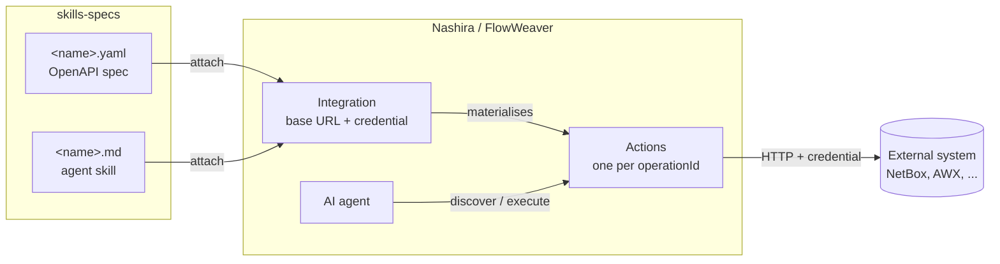
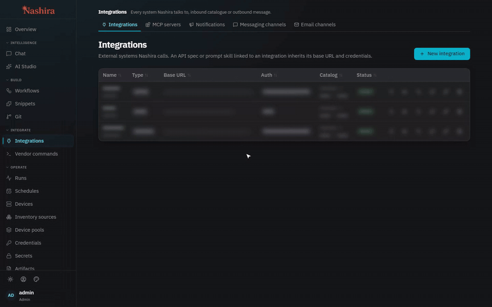

<div align="center">

# skills-specs

**The official catalog of integration specs and agent skills for Nashira and FlowWeaver.**

One OpenAPI spec tells the agent *what* an external system can do.
One skill tells it *how* to use it well.
Attach both to an integration and the agent can drive that system on its own.

[Catalog](#catalog) · [How it works](#how-it-works) · [Load from the UI](#load-from-the-ui) · [Quick start](#quick-start-api) · [Conventions](#conventions) · [Contributing](#contributing)

</div>

---

## Catalog

| Integration | Domain | Operations | Spec | Skill |
| --- | --- | ---: | --- | --- |
| **Action1** | Patch management and RMM: endpoints, patching, vulnerabilities, software inventory, automations | 58 | [`action1.yaml`](action1/action1.yaml) | [`action1.md`](action1/action1.md) |
| **AWX** | Ansible automation: job templates, inventories, projects, credentials, plus Git operations | 160 | [`awx.yaml`](awx/awx.yaml) | [`awx.md`](awx/awx.md) |
| **Infoblox** | WAPI v2.12: DNS views, zones and records, IPAM and DHCP (IPv4 and IPv6), grid, global search | 142 | [`infoblox.yaml`](infoblox/infoblox.yaml) | [`infoblox.md`](infoblox/infoblox.md) |
| **NetBox** | NetBox 4.4 inventory and IPAM: devices, interfaces, cables, IP addresses, prefixes, VLANs, VRFs, circuits, tenants, tags | 76 | [`netbox.yaml`](netbox/netbox.yaml) | [`netbox.md`](netbox/netbox.md) |
| **ServiceNow** | Table API: incidents, changes, CMDB, directory, generic reads | 15 | [`servicenow.yaml`](servicenow/servicenow.yaml) | [`servicenow.md`](servicenow/servicenow.md) |

## How it works



- **The spec** is plain OpenAPI 3. Every `operationId` becomes an action on the
  integration, callable as `<api>:<operationId>` (for example `netbox:dcim_cables_create`).
- **The skill** carries what a spec cannot express: which operation to pick for a
  task, filters that actually work, pagination, write recipes, and the traps of each
  system.
- **Nothing is global.** Both files are attached to one integration, inherit its base URL
  and credential, and reach the agent's prompt only when that integration is in scope.

### One catalog, two products

|  | Nashira | FlowWeaver |
| --- | --- | --- |
| Routes | `/api/integrations/{id}/specs` · `/skills` · `/check` | `/api/integration/{id}/specs` · `/skills` · `/health` |
| Skill ordering field | `priority` | `sort_order` |
| How the agent uses it | agent tools: `discover_operations`, `operation_detail`, `execute_operation` | the same agent tools, plus `integration_action` nodes and python snippets inside workflows |

Both products **upsert** on the spec `api` and the skill `name`, and re-materialise the
integration's actions in the same call. Existing actions are matched by operation and
keep their ids, so workflows that reference them keep working when a spec is updated.

## Load from the UI

The fastest path: create the integration, pick the spec and the skill from this repo, and
let the product build the action catalog. The recordings below use a throwaway
`netbox-demo` integration; hosts and URLs are blurred.

### Nashira

*Integrations → New integration.* One dialog covers the whole setup:

1. **Integration** tab: name, type, base URL and a stored credential from
   *Credentials*. NetBox expects the `Token` authorization scheme; tick
   **Allow private network** when NetBox runs on an internal address.
2. **API specs** tab: *Choose .yaml files* → `netbox.yaml`. The api name is read from the file.
3. **Skills** tab: *Choose .md files* → `netbox.md`, scoped to this integration.
4. **Create.** The integration, the spec, the skill and the 76 actions land in one step.

Then press the row's **Test** button: with a valid token the status turns *healthy*.

<p align="center">
  
</p>

### FlowWeaver

1. *Integrations → New integration*: name, type, base URL and auth method. Tick
   **Allow private-network targets** when NetBox runs on an internal address.
2. Open the new integration: **Load spec** → *Upload .yaml* → `netbox.yaml` → *Attach spec*.
   The 76 operations become actions.
3. **Load skill** → *Upload .md* → `netbox.md` → *Attach skill*.
4. **Health check**: the status dot turns green. Set *Health check path* to an
   authenticated endpoint such as `/api/status/`, so a wrong token shows as unhealthy
   instead of passing a plain reachability probe.

<p align="center">
  
</p>

> **Names are unique per instance in FlowWeaver.** A spec `api` or a skill `name` that
> already exists is *moved* to the integration you attach it to, and its content is
> replaced. The recording above uses `netbox-demo` because the lab already has a NetBox
> integration called `netbox`. Reuse a name only to update that same integration.

## Quick start (API)

You need an existing integration (base URL and credential already set) and an admin login.

**1. Log in**

```bash
BASE=http://<host>:<port>          # Nashira backend or FlowWeaver frontend
TOKEN=$(curl -s -X POST "$BASE/api/auth/login" \
  -H 'Content-Type: application/json' \
  -d '{"username":"<admin>","password":"<password>"}' | jq -r .access_token)
```

**2. Attach the spec and the skill**

```bash
ID=<integration-id>
ROUTE=integrations          # Nashira; use "integration" for FlowWeaver

jq -n --rawfile c netbox/netbox.yaml '{api: "netbox", content: $c}' |
  curl -s -X POST "$BASE/api/$ROUTE/$ID/specs" \
       -H "Authorization: Bearer $TOKEN" -H 'Content-Type: application/json' -d @-

jq -n --rawfile c netbox/netbox.md '{name: "netbox", content: $c, priority: 100}' |
  curl -s -X POST "$BASE/api/$ROUTE/$ID/skills" \
       -H "Authorization: Bearer $TOKEN" -H 'Content-Type: application/json' -d @-
```

For FlowWeaver, send `sort_order` instead of `priority`.

**3. Check it**

```bash
curl -s -X POST "$BASE/api/$ROUTE/$ID/check" -H "Authorization: Bearer $TOKEN"   # FlowWeaver: /health
```

Then ask the agent: *"discover_operations(api="netbox", keyword="cable")"*.

> Keep the api name the integration already uses. Operations are called as
> `<api>:<operationId>`, and the skill names them with that prefix. If you attach a spec
> under a different api name, update the prefix inside the skill to match.

## Conventions

```
<name>/
├── <name>.yaml    OpenAPI 3 spec — the operations the agent may call
└── <name>.md      agent skill — how to use them well
```

**Specs**

- OpenAPI 3.0 or 3.1, one file, no external `$ref`s.
- `operationId` is mandatory, unique and stable: it is the action's identity. Renaming
  one breaks every workflow that calls it. Prefer the vendor's own ids
  (`dcim_devices_list`, `ipam_ip_addresses_partial_update`).
- Leave `servers` out, or treat it as documentation only: the integration's base URL wins.
- No credentials, tokens or hostnames from a real environment.
- Write operations are deliberate. Prefer `PATCH` over `PUT` (a `PUT` clears every field
  left out), and leave `DELETE` out unless removing data is a task the agent should own.

**Skills**

- Written in English, in Markdown.
- Start with the api prefix and the domain the integration owns.
- Name operations exactly as the spec does, with the prefix.
- Spend words on what the spec cannot say: which operation answers which question, filter
  syntax, pagination, write recipes, error meanings and gotchas. Do not restate the spec.

## Contributing

1. Create `<name>/<name>.yaml` and `<name>/<name>.md`.
2. Validate the spec against the real system or its published schema: paths, methods,
   parameters, request bodies, required fields and enum values.
3. Attach both to a test integration in Nashira and in FlowWeaver, run the health check,
   and have the agent complete a real read and a real write.
4. Add a row to the [catalog](#catalog).
5. When you change an existing spec, never rename or drop an `operationId` without
   checking which workflows call it.
